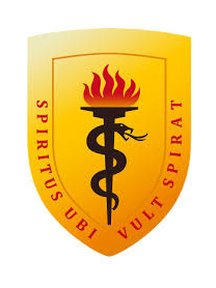
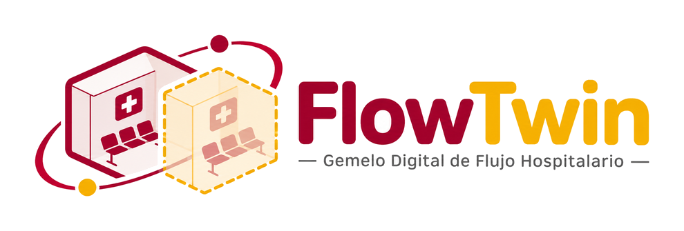
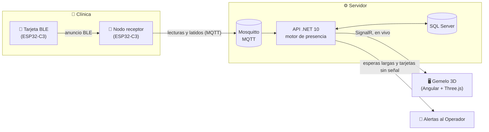
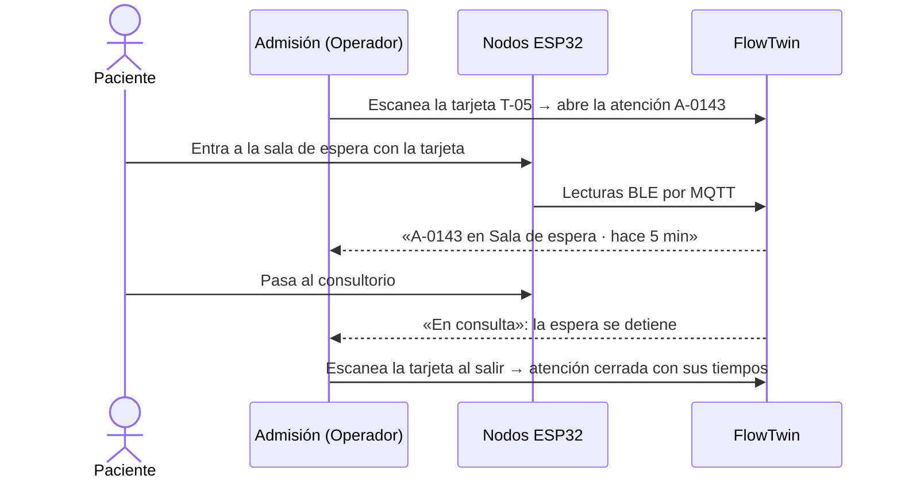
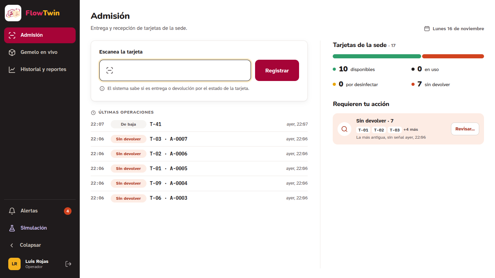
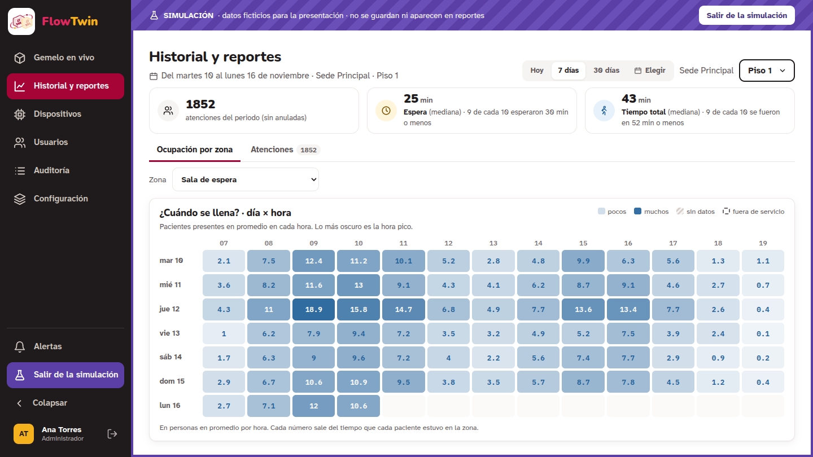
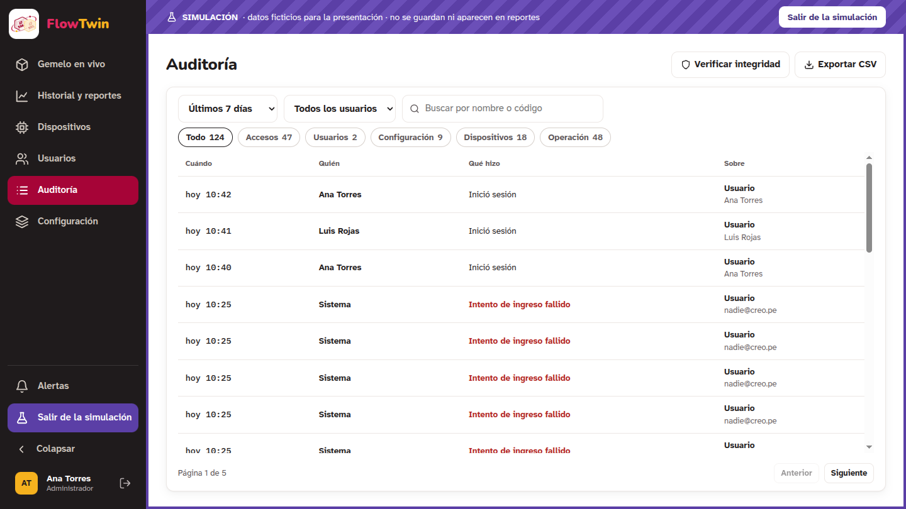

<table>
  <tr>
    <td></td>
    <td>
      <h1>UNIVERSIDAD PERUANA CAYETANO HEREDIA</h1>
      <b>Facultad de Ciencias e Ingeniería</b> · Proyectos de Ingeniería II · 8.º ciclo · 2026
    </td>
  </tr>
</table>

<p align="center">
  
</p>

<h1 align="center">CREO FlowTwin</h1>
<p align="center"><b>Gemelo digital del flujo de pacientes</b></p>

<p align="center">
  <a href="https://github.com/Emmy-Abigail/FlowTwin-CREO/actions/workflows/ci.yml"></a>
  
  
  
  
  
  
  
</p>

<p align="center">
  Tarjetas <b>BLE anónimas</b> y nodos <b>ESP32</b> muestran en un <b>gemelo 3D</b> dónde está cada paciente, cuánto espera
  y qué zona se está llenando, <b>en vivo</b>, para que la clínica actúe a tiempo y decida con datos.
</p>

---

## 📑 Tabla de contenidos

- [📘 Introducción](#-introducción)
- [🏥 Problemática](#-problemática)
- [🎯 Objetivos](#-objetivos)
- [⚙️ ¿Cómo funciona?](#️-cómo-funciona)
- [🖥️ Componentes del sistema](#️-componentes-del-sistema)
- [👥 Roles y pantallas](#-roles-y-pantallas)
- [🛠️ Tecnologías](#️-tecnologías)
- [🔒 Privacidad y seguridad](#-privacidad-y-seguridad)
- [🚀 Instalación y uso](#-instalación-y-uso)
- [🗂️ Estructura del repositorio](#️-estructura-del-repositorio)
- [📚 Documentación](#-documentación)
- [🛣️ Hoja de ruta](#️-hoja-de-ruta)
- [💡 ¿Qué nos impulsa?](#-qué-nos-impulsa)
- [🧑‍💻 ¿Quiénes somos?](#-quiénes-somos)

---

## 📘 Introducción

**CREO FlowTwin** nace en la **Clínica Renal y Oncológica CREO+**, donde los pacientes recorren varias zonas
(admisión, sala de espera, triaje, consulta y tratamiento) sin que nadie pueda ver ese recorrido completo mientras
ocurre.

Un **gemelo digital** es una réplica virtual de un lugar real que se actualiza con lo que pasa en él. FlowTwin
construye esa réplica en 3D a partir de los planos de la clínica y la alimenta con la posición de cada paciente,
detectada con tarjetas BLE y nodos ESP32, **sin guardar ningún dato personal**.

> *FlowTwin* une *flow* (flujo) y *twin* (gemelo): el gemelo del flujo de pacientes.

---

## 🏥 Problemática

<p align="center">
  
</p>

### ⏳ Esperas que nadie ve

Recepción no sabe dónde está cada paciente ni cuánto lleva esperando. Una espera larga se descubre cuando el paciente
se queja o cuando ya se fue sin ser atendido.

### 🚧 Cuellos de botella invisibles

Cuando la sala de espera se llena, no se sabe por qué: si faltan consultorios libres, si es la hora del día o si un
servicio concreto se está atrasando. Sin ese dato, la clínica no puede corregir la causa.

### 📉 Decisiones sin datos

Cambiar horarios, reforzar un servicio o redistribuir al personal se decide por intuición, porque los tiempos reales
de espera y de atención nunca se midieron de forma continua.

### ⚠️ El problema común

La clínica no tiene una forma **objetiva, continua y respetuosa de la privacidad** de saber cómo fluyen sus pacientes,
ni en el momento ni en el historial.

---

## 🎯 Objetivos

### Objetivo general

Desarrollar un gemelo digital del flujo de pacientes que, a partir de tarjetas BLE anónimas y nodos IoT, muestre en
tiempo real la ubicación, las esperas y la ocupación de cada zona de la clínica, y conserve el historial para la
toma de decisiones.

### Objetivos específicos

- **Detectar en qué zona está cada paciente** con nodos ESP32 que escuchan tarjetas BLE, sin datos personales.
- **Mostrar el estado en vivo** en una maqueta 3D del piso: ocupación por zona, pacientes esperando y en consulta.
- **Alertar al Operador** solo cuando hace falta actuar: esperas largas y tarjetas sin señal.
- **Medir y conservar los tiempos** de espera y de atención para ver cuándo y dónde se forman los cuellos de botella.
- **Dar a cada rol solo lo que necesita**, con permisos, auditoría y seguridad aptos para una clínica real.

---

## ⚙️ ¿Cómo funciona?



1. **En admisión** el Operador escanea una tarjeta y se abre una atención con un código anónimo (por ejemplo `A-0143`).
2. **Los nodos de cada zona** escuchan las tarjetas y envían por MQTT la intensidad de la señal (RSSI).
3. **El motor de presencia** decide en qué zona está cada paciente, con un margen que evita saltos falsos al pasar por
   una puerta.
4. **El gemelo 3D se actualiza al instante**: cada zona se pinta según su ocupación y aparece la lista de pacientes.
5. **Las alertas** avisan solo lo que pide actuar, y el Operador puede marcarlas como «Enterado».
6. **Al salir**, el paciente devuelve la tarjeta y la atención se cierra con sus tiempos, que alimentan el historial.

<details>
<summary><b>Ver el recorrido de un paciente como secuencia</b></summary>



</details>

> Si no hay nodos instalados, el modo **Simulación** muestra el gemelo y el historial con pacientes ficticios, marcados
> en morado, para presentar el sistema sin hardware.

---

## 🖥️ Componentes del sistema

### 📡 Hardware IoT

| Elemento | Cantidad (piloto) | Función |
|---|---|---|
| **Nodo receptor** ESP32-C3 | 3 | Escaneo BLE pasivo en su zona; envía lecturas y latidos por MQTT con su propia cuenta |
| **Tarjeta emisora** ESP32-C3 | 10 | Anuncio BLE con un identificador; se entrega al paciente en admisión |

El acuerdo entre el firmware y el servidor está en el [contrato con los nodos](docs/contrato-integracion-nodos.md).

### ⚙️ Servidor

API **.NET 10** organizada en módulos (Identidad, Gemelo, Dispositivos, Atenciones, Monitoreo, Reportes, Auditoría y
Mensajería), con **SQL Server** como base de datos y **Mosquitto** como broker MQTT.

### 🖥️ Aplicación web

Angular 22, pensada para usarse sin scroll en una pantalla de 1280 × 720.

<table>
  <tr>
    <td width="50%"><br/><b>Admisión.</b> Un solo campo: el sistema sabe si la tarjeta se entrega o se devuelve.</td>
    <td width="50%"><br/><b>Historial.</b> ¿Cuándo se llena cada zona? Mapa día × hora, medianas y exportación CSV.</td>
  </tr>
  <tr>
    <td><br/><b>Auditoría.</b> Quién hizo qué y cuándo, con el antes y el después y un sello de integridad.</td>
    <td><br/><b>Configuración.</b> Sedes, pisos, zonas, aforos y parámetros, sin programar.</td>
  </tr>
  <tr>
    <td colspan="2" align="center"><br/><b>Dispositivos.</b> Nodos y tarjetas por excepción: primero lo que requiere atención.</td>
  </tr>
</table>

---

## 👥 Roles y pantallas

| Pantalla | Operador | Gerencia | Administrador |
|---|:---:|:---:|:---:|
| Admisión (entregar y recibir tarjetas) | ✅ | | |
| Gemelo en vivo | ✅ sus pisos | 👁️ todos | ✅ todos |
| Alertas y zona fuera de servicio | ✅ | | ✅ |
| Historial y reportes (CSV) | ✅ | 👁️ | ✅ |
| Detalle de una atención | ✅ | 👁️ | ✅ |
| Dispositivos, Usuarios, Auditoría y Configuración | | | ✅ |

👁️ = solo lectura. Los permisos se comprueban en el servidor, no solo en la pantalla.

<details>
<summary><b>¿Qué hace cada rol en un día normal?</b></summary>

- **Operador (recepción):** entrega una tarjeta a cada paciente que llega, mira el gemelo para saber a quién hacer
  pasar, atiende las alertas y recibe la tarjeta al salir.
- **Gerencia:** revisa los indicadores en vivo de cualquier piso y el historial para decidir horarios y refuerzos.
- **Administrador:** configura sedes, pisos, zonas y aforos; registra nodos y tarjetas; gestiona usuarios y revisa la
  auditoría.

</details>

---

## 🛠️ Tecnologías

| Capa | Tecnología | Para qué |
|---|---|---|
| Backend | **.NET 10** · ASP.NET Core · EF Core 10 | API REST, monolito modular |
| Base de datos | **SQL Server 2022** | Datos, catálogos y bitácora (todo en UTC) |
| Tiempo real | **SignalR** | El gemelo se actualiza sin recargar |
| IoT | **MQTT** · Mosquitto 2 · MQTTnet | Una cuenta por nodo, con sus propios temas y límites |
| Frontend | **Angular 22** · Signals · SCSS | Pantallas por rol |
| 3D | **Three.js** | Maqueta generada desde el plano del piso ([generador](tools/generador-modelo-3d/README.md)) |
| Hardware | **ESP32-C3** | Nodos receptores y tarjetas BLE |
| Calidad | xUnit · Vitest · GitHub Actions · OWASP ZAP · k6 | Pruebas, integración continua y seguridad |

---

## 🔒 Privacidad y seguridad

- 🕶️ **Pacientes anónimos:** solo un código como `A-0143`; ningún nombre ni documento entra al sistema (Ley 29733).
- 🔑 **Acceso por rol:** cada pantalla y cada acción se autoriza en el servidor; Gerencia es de solo lectura.
- 🛡️ **Contra abusos:** límite de peticiones en toda la API y bloqueo tras 5 intentos de contraseña.
- 🔐 **Contraseñas según OWASP ASVS:** 12 caracteres o más (una frase vale) y se rechazan las filtradas en ataques conocidos.
- 📜 **Auditoría sellada:** cada cambio queda registrado con su antes y después, y una cadena de sellos revela si
  alguien alteró la bitácora directamente en la base.
- 📡 **Nodos con cuenta propia:** cada ESP32 solo puede publicar en sus temas MQTT.

| Prueba | Resultado |
|---|---|
| Escaneo OWASP ZAP de toda la API | 0 fallos y 0 advertencias en 213 URL |
| Avalancha de peticiones (k6) | más de 1 millón en 30 s; el usuario normal fue atendido el 100 % de las veces |
| Dependencias | 0 vulnerabilidades conocidas (.NET y npm) |
| Pruebas automáticas | 230 unitarias · 18 de arquitectura · 120 de integración · 198 del frontend |

Detalle y evidencia en el [informe de seguridad](docs/seguridad/informe-seguridad.md) (OWASP ASVS nivel 1).

---

## 🚀 Instalación y uso

### Requisitos

- Git y Docker
- [.NET SDK 10](https://dotnet.microsoft.com/download)
- Node.js 24.15 (con [nvm](https://github.com/nvm-sh/nvm))

### 1. Base de datos y broker MQTT

```bash
git clone https://github.com/Emmy-Abigail/FlowTwin-CREO.git
cd FlowTwin-CREO/backend
cp .env.example .env        # completar con tus propias contraseñas
docker compose up -d        # SQL Server y Mosquitto (o docker-compose up -d)
```

### 2. Secretos de la API (solo la primera vez)

Se guardan fuera del repositorio. **Cada persona genera los suyos; nunca se comparten.**

```bash
SA=$(grep MSSQL_SA_PASSWORD .env | cut -d= -f2)
dotnet user-secrets set "ConnectionStrings:FlowTwin" \
  "Server=localhost,1433;Database=FlowTwin;User Id=sa;Password=$SA;TrustServerCertificate=True;Encrypt=True" \
  --project src/FlowTwin.Api
dotnet user-secrets set "Jwt:Clave" "$(openssl rand -base64 64 | tr -d '\n')" --project src/FlowTwin.Api
dotnet user-secrets set "Mqtt:ClaveAdmin" "$(grep MQTT_ADMIN_CLAVE .env | cut -d= -f2)" --project src/FlowTwin.Api
dotnet user-secrets set "Auditoria:ClaveSello" "$(openssl rand -base64 48 | tr -d '\n')" --project src/FlowTwin.Api
```

### 3. API

```bash
dotnet tool restore
dotnet run --project src/FlowTwin.Api     # http://localhost:5080
```

La primera vez crea la base, aplica las migraciones y siembra los datos de demostración.

### 4. Aplicación web

```bash
cd ../frontend/flowtwin-web
nvm use 24.15.0
npm install
npm start                                 # http://localhost:4200
```

Entra con un usuario de demostración (contraseña `demo123`; solo existen en desarrollo):

| Rol | Correo |
|---|---|
| Administrador | `admin@creo.pe` |
| Operador | `operador@creo.pe` |
| Gerencia | `gerencia@creo.pe` |

### 5. Pruebas

```bash
cd backend && dotnet test                  # unitarias, de arquitectura y de integración
cd frontend/flowtwin-web && npx ng test    # frontend
```

El detalle técnico (cuentas MQTT, administrador inicial, migraciones y el simulador que publica lecturas como los
ESP32) está en el [README del backend](backend/README.md).

---

## 🗂️ Estructura del repositorio

```
├── backend/                     # API .NET 10, pruebas, docker-compose (SQL Server y Mosquitto)
│   ├── src/FlowTwin.Api/        # Arranque, seguridad, errores
│   ├── src/Modules/             # Identidad, Gemelo, Dispositivos, Atenciones, Monitoreo, Reportes, Auditoría, Mensajería
│   ├── src/FlowTwin.Persistence/# EF Core y migraciones
│   ├── tests/                   # Unitarias, de integración y de arquitectura
│   └── tools/FlowTwin.Simulador/# Simula los nodos ESP32 por MQTT
├── frontend/flowtwin-web/       # Aplicación web Angular (una carpeta por pantalla)
├── maquetas/piso-1/             # Maqueta 3D del Piso 1 (en el repositorio solo para la demo)
├── tools/
│   ├── generador-modelo-3d/     # Genera la maqueta 3D desde el plano
│   └── seguridad/               # Pruebas de seguridad repetibles (OWASP ZAP y k6)
└── docs/                        # ADR, contrato con los nodos, despliegue e informe de seguridad
```

---

## 📚 Documentación

| Documento | Para quién |
|---|---|
| [Contrato con los nodos](docs/contrato-integracion-nodos.md) | Equipo de hardware (firmware de los ESP32) |
| [Decisiones de arquitectura (ADR)](docs/adr/README.md) | Equipo técnico; las anteriores al ADR-21 están en el documento de arquitectura |
| [Informe de seguridad](docs/seguridad/informe-seguridad.md) | Evaluación y auditoría |
| [Despliegue](docs/despliegue.md) | Quien instale el sistema: demo en la nube y servidor de la clínica |
| [Backend](backend/README.md) · [Generador 3D](tools/generador-modelo-3d/README.md) | Desarrollo |

---

## 🛣️ Hoja de ruta

- [x] Admisión con tarjetas BLE anónimas
- [x] Ingesta de los nodos por MQTT, con una cuenta por nodo
- [x] Gemelo en vivo sobre la maqueta 3D del Piso 1
- [x] Alertas contra la fatiga y zona fuera de servicio
- [x] Historial con mapa día × hora y exportación CSV
- [x] Pantallas del Administrador: dispositivos, usuarios, auditoría y configuración
- [x] Endurecimiento de seguridad e informe con OWASP ZAP y k6
- [x] Contraseñas según OWASP ASVS: 12 caracteres o una frase, y sin contraseñas filtradas
- [ ] Demostración en la nube para la clínica
- [ ] Instalación de los nodos y las tarjetas en la clínica (MQTT con TLS)
- [ ] Respaldos automáticos y despliegue en la nube de la clínica
- [ ] Nivel de batería de las tarjetas

---

## 💡 ¿Qué nos impulsa?

Nos motiva que el tiempo de un paciente en la clínica se respete. Detrás de cada espera larga hay una persona que ya
llega preocupada por su salud. Queremos que el personal de la clínica tenga una herramienta simple y confiable para
ver lo que hoy es invisible, actuar a tiempo y mejorar con datos reales.

## 🧑‍💻 ¿Quiénes somos?

Somos un equipo de estudiantes de la **Facultad de Ciencias e Ingeniería** de la **Universidad Peruana Cayetano
Heredia**, en el curso **Proyectos de Ingeniería II** (8.º ciclo, 2026).

| Integrante | Rol |
|---|---|
| **Emmy Lopez** | Software y Analítica |
| Vanesa Rioja | Gestión del proyecto y Calidad |
| Juan Aquino | Hardware IoT |

---

<p align="center">
  <sub>© 2026 Equipo CREO FlowTwin · Universidad Peruana Cayetano Heredia. Todos los derechos reservados. Ver <a href="LICENSE">LICENSE</a>.</sub>
</p>
