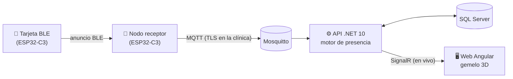
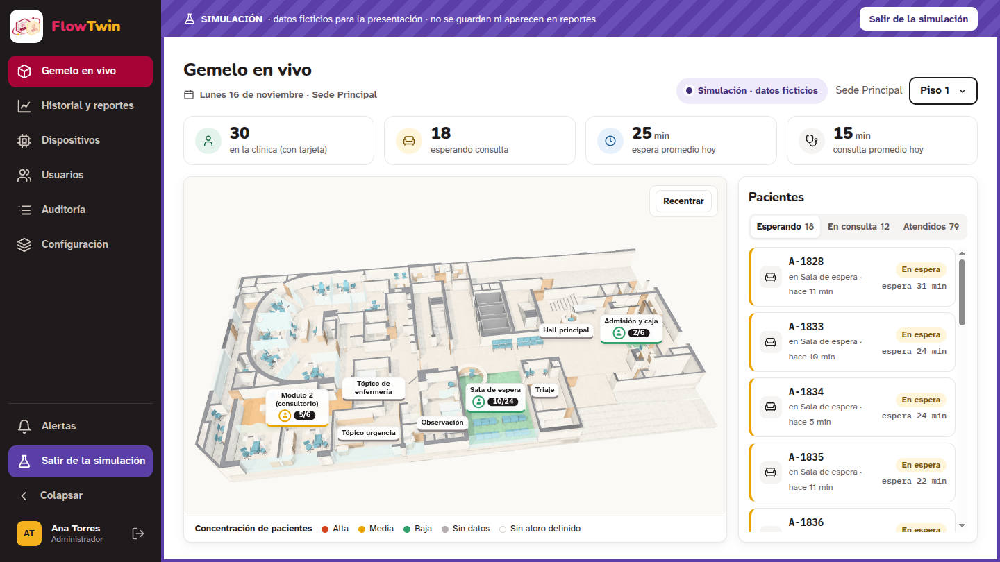
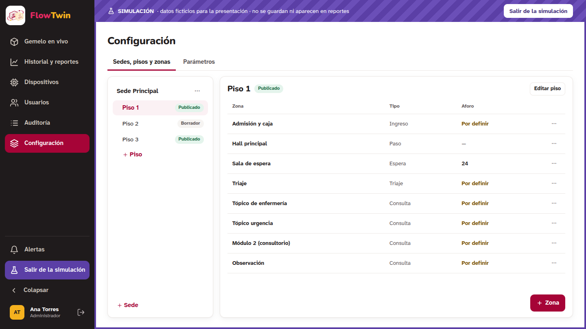
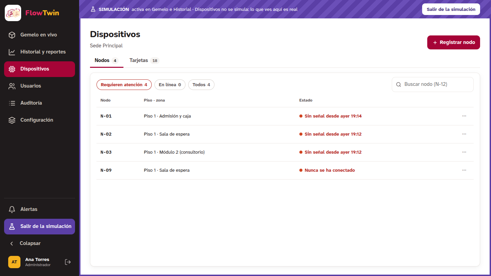
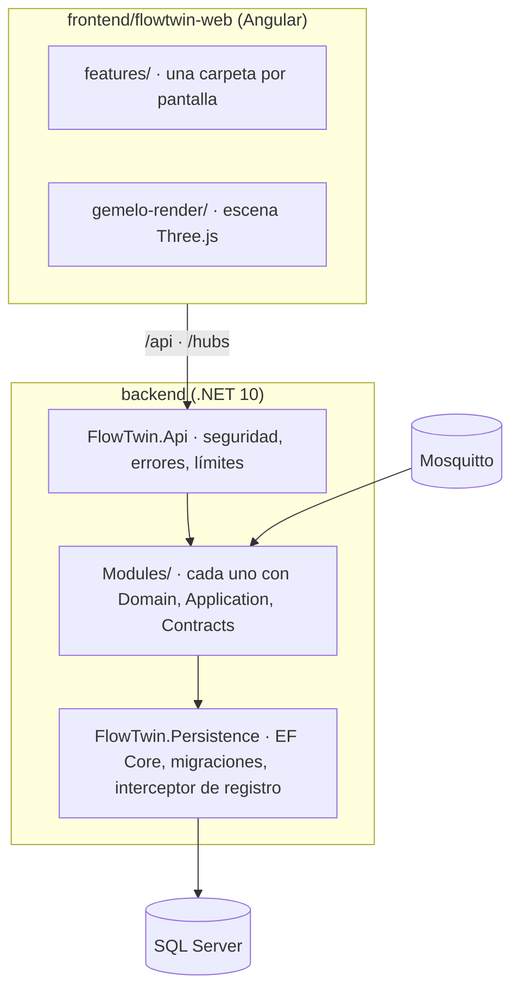

<div align="center">


&nbsp;&nbsp;&nbsp;&nbsp;

&nbsp;&nbsp;&nbsp;&nbsp;


# CREO FlowTwin

**Gemelo digital del flujo de pacientes de la Clínica Renal y Oncológica CREO+**

Dónde está cada paciente, cuánto espera y qué zona se está llenando, en vivo y en 3D,
con tarjetas BLE anónimas y nodos ESP32. Sin datos personales.

[](https://github.com/Emmy-Abigail/FlowTwin-CREO/actions/workflows/ci.yml)


Proyecto de la **Universidad Peruana Cayetano Heredia** · Facultad de Ciencias e Ingeniería<br>
Curso **Proyectos de Ingeniería II** · 8.º ciclo · 2026

[El problema](#-el-problema) · [La solución](#-la-solución) · [Capturas](#-capturas) · [Roles](#-roles-y-pantallas) ·
[Tecnologías](#-tecnologías) · [Arquitectura](#-arquitectura) · [Cómo correrlo](#-cómo-correrlo) ·
[Calidad y seguridad](#-calidad-y-seguridad) · [Documentación](#-documentación) · [Equipo](#-equipo)

</div>

---

## 🩺 El problema

En una clínica, el recorrido de cada paciente (admisión, sala de espera, triaje, consulta o tratamiento) ocurre
sin que nadie lo vea completo:

- **Nadie sabe dónde está cada paciente ni cuánto lleva esperando.** Recepción se entera de una espera larga
  cuando el paciente se queja.
- **Los cuellos de botella no se ven.** No se sabe si la sala de espera se llena porque faltan consultorios
  libres, por la hora del día o por un servicio concreto.
- **Las decisiones se toman sin datos.** Cambiar horarios o reforzar un servicio se decide por intuición, porque
  los tiempos reales nunca se midieron.

## 💡 La solución

Un **gemelo digital**: una réplica en 3D de la clínica que se actualiza sola con lo que pasa en el piso real.

1. En admisión, el paciente recibe una **tarjeta BLE** con un código anónimo (por ejemplo `A-0143`). Su nombre
   nunca entra al sistema.
2. **Nodos ESP32** en cada zona escuchan las tarjetas y envían lo que detectan por **MQTT**.
3. El servidor decide en qué zona está cada paciente y calcula esperas y ocupación.
4. Cada rol ve lo que necesita: el **Operador** a quién atender y las alertas, **Gerencia** los indicadores y el
   historial, y el **Administrador** la configuración, los dispositivos, los usuarios y la auditoría.



<details>
<summary><b>Recorrido de un paciente, paso a paso</b></summary>

```mermaid
sequenceDiagram
    actor P as Paciente
    participant A as Admisión (Operador)
    participant N as Nodos ESP32
    participant S as FlowTwin
    A->>S: Escanea la tarjeta T-05 → abre la atención A-0143
    P->>N: Entra a la sala de espera con la tarjeta
    N->>S: Lecturas BLE por MQTT
    S-->>A: El gemelo muestra a A-0143 «en Sala de espera · hace 5 min»
    P->>N: Pasa al consultorio
    S-->>A: Cambia a «En consulta»; la espera se detiene (RN-06)
    A->>S: Escanea la tarjeta al salir → atención cerrada con sus tiempos
```

</details>

## 📸 Capturas

<table>
  <tr>
    <td width="50%"><br><b>Gemelo en vivo.</b> Cada zona pintada por su ocupación sobre la maqueta 3D, los indicadores del día y la lista de pacientes.</td>
    <td width="50%"><br><b>Admisión.</b> Un solo campo: el sistema sabe si la tarjeta se entrega o se devuelve.</td>
  </tr>
  <tr>
    <td><br><b>Historial.</b> ¿Cuándo se llena cada zona? Mapa día × hora, medianas de espera y exportación CSV.</td>
    <td><br><b>Auditoría.</b> Quién hizo qué y cuándo, con el antes y el después y un sello de integridad.</td>
  </tr>
  <tr>
    <td><br><b>Configuración.</b> Sedes, pisos, zonas, aforos y parámetros, sin programar.</td>
    <td><br><b>Dispositivos.</b> Nodos y tarjetas por excepción: primero lo que requiere atención.</td>
  </tr>
</table>

<sub>Las capturas del gemelo y del historial usan el modo <b>Simulación</b> (datos ficticios, marcados en morado) porque los nodos reales aún no están instalados.</sub>

## 👥 Roles y pantallas

| Pantalla | Operador | Gerencia | Administrador |
|---|:---:|:---:|:---:|
| Admisión (entregar y recibir tarjetas) | ✅ | | |
| Gemelo en vivo | ✅ sus pisos | 👁️ todos | ✅ todos |
| Alertas y zona fuera de servicio | ✅ | | ✅ |
| Historial y reportes (CSV) | ✅ | 👁️ | ✅ |
| Detalle de una atención | ✅ | 👁️ | ✅ |
| Dispositivos (nodos y tarjetas) | | | ✅ |
| Usuarios | | | ✅ |
| Auditoría | | | ✅ |
| Configuración | | | ✅ |

👁️ = solo lectura. Las reglas se aplican en el servidor, no solo en la pantalla.

<details>
<summary><b>¿Qué hace cada rol en un día normal?</b></summary>

- **Operador (recepción):** entrega una tarjeta a cada paciente que llega, mira el gemelo para saber a quién
  hacer pasar, atiende las alertas (esperas largas, tarjetas sin señal) y recibe la tarjeta al salir.
- **Gerencia:** revisa los indicadores en vivo de cualquier piso y el historial para decidir horarios y
  refuerzos. No modifica nada.
- **Administrador:** configura sedes, pisos, zonas y aforos; registra nodos y tarjetas; crea usuarios y
  revisa la auditoría.

</details>

## 🛠️ Tecnologías

| Capa | Tecnología | Para qué |
|---|---|---|
| Backend | **.NET 10** · ASP.NET Core · EF Core 10 | API REST, monolito modular (Identidad, Gemelo, Dispositivos, Atenciones, Monitoreo, Reportes, Auditoría, Mensajería) |
| Base de datos | **SQL Server 2022** | Datos, catálogos y bitácora; todo en UTC |
| Tiempo real | **SignalR** | El gemelo se actualiza sin recargar |
| Mensajería IoT | **MQTT** · Mosquitto 2 · MQTTnet | Una cuenta por nodo, con sus propios temas y límites |
| Frontend | **Angular 22** · Signals · SCSS | Pantallas por rol, sin scroll a 1280 × 720 |
| 3D | **Three.js** | Maqueta del piso generada desde los planos (`tools/generador-modelo-3d`) |
| Hardware | **ESP32-C3** | 3 nodos receptores (escaneo BLE pasivo, RSSI) y 10 tarjetas emisoras BLE |
| Calidad | xUnit · Vitest · GitHub Actions · OWASP ZAP · k6 | Pruebas, integración continua y pruebas de seguridad |

## 🧱 Arquitectura



- **Monolito modular:** cada módulo solo usa los `Contracts` de otro; las pruebas de arquitectura lo verifican
  en cada compilación.
- **Decisiones registradas:** cada decisión importante tiene su ADR en [`docs/adr/`](docs/adr/README.md). Las
  anteriores al ADR‑21 están en el documento de arquitectura del proyecto.

<details>
<summary><b>Estructura del repositorio</b></summary>

```
backend/                 API .NET, pruebas, docker-compose (SQL Server y Mosquitto), simulador de nodos
frontend/flowtwin-web/   Aplicación web Angular
maquetas/piso-1/         Maqueta 3D del Piso 1 (en el repositorio solo para la demo; ver ADR-28)
tools/generador-modelo-3d/  Genera la maqueta 3D desde el plano del piso
tools/seguridad/         Pruebas de seguridad repetibles (OWASP ZAP y k6)
docs/                    ADR, contrato con el hardware, pantallas e informe de seguridad
```

</details>

## 🚀 Cómo correrlo

**Necesitas:** Git, Docker, [.NET SDK 10](https://dotnet.microsoft.com/download) y Node.js 24.15 (con
[nvm](https://github.com/nvm-sh/nvm)).

<details open>
<summary><b>1. Base de datos y broker MQTT</b></summary>

```bash
cd backend
cp .env.example .env        # y pon tus propias contraseñas en .env
docker compose up -d        # SQL Server y Mosquitto (o docker-compose up -d)
docker compose ps           # espera «(healthy)» en los dos
```

</details>

<details open>
<summary><b>2. Secretos de la API (solo la primera vez)</b></summary>

Se guardan fuera del repositorio, en tu usuario. **Cada persona genera los suyos; nunca se comparten.**

```bash
SA=$(grep MSSQL_SA_PASSWORD .env | cut -d= -f2)
dotnet user-secrets set "ConnectionStrings:FlowTwin" \
  "Server=localhost,1433;Database=FlowTwin;User Id=sa;Password=$SA;TrustServerCertificate=True;Encrypt=True" \
  --project src/FlowTwin.Api
dotnet user-secrets set "Jwt:Clave" "$(openssl rand -base64 64 | tr -d '\n')" --project src/FlowTwin.Api
dotnet user-secrets set "Mqtt:ClaveAdmin" "$(grep MQTT_ADMIN_CLAVE .env | cut -d= -f2)" --project src/FlowTwin.Api
dotnet user-secrets set "Auditoria:ClaveSello" "$(openssl rand -base64 48 | tr -d '\n')" --project src/FlowTwin.Api
```

</details>

<details open>
<summary><b>3. API</b></summary>

```bash
dotnet tool restore
dotnet run --project src/FlowTwin.Api     # http://localhost:5080
```

La primera vez crea la base, aplica las migraciones y siembra los datos de demostración.

</details>

<details open>
<summary><b>4. Web</b></summary>

```bash
cd ../frontend/flowtwin-web
nvm use 24.15.0
npm install
npm start                                 # http://localhost:4200
```

</details>

Entra en <http://localhost:4200> con un usuario de demostración. La contraseña es `demo123`, y estos usuarios
solo existen en desarrollo:

| Rol | Correo |
|---|---|
| Administrador | `admin@creo.pe` |
| Operador | `operador@creo.pe` |
| Gerencia | `gerencia@creo.pe` |

En el menú, **Simulación** muestra el gemelo y el historial con pacientes ficticios, para presentar el sistema
sin hardware. La maqueta 3D del Piso 1 ya viene en `maquetas/piso-1/`.

<details>
<summary><b>Más: pruebas, migraciones y simulador de nodos</b></summary>

```bash
cd backend && dotnet test                         # unitarias, de arquitectura y de integración
cd frontend/flowtwin-web && npx ng test           # frontend
```

El detalle técnico del backend (cuentas MQTT, administrador inicial, migraciones y el simulador que publica
lecturas como los ESP32) está en [`backend/README.md`](backend/README.md).

</details>

## ✅ Calidad y seguridad

| | |
|---|---|
| Pruebas automáticas | 223 unitarias · 18 de arquitectura · 119 de integración (contra SQL Server real) · 195 del frontend |
| Integración continua | Cada pull request compila y prueba todo; solo se une en verde |
| Escaneo OWASP ZAP | 0 fallos y 0 advertencias en 213 URL de la API, con sesión de Administrador |
| Prueba de carga (k6) | Un abusador con más de 1 millón de peticiones en 30 s no afectó a un usuario normal (100 % atendido, p95 = 9,9 ms) |
| Dependencias | 0 vulnerabilidades conocidas (.NET y npm) |
| Privacidad | Pacientes anónimos (Ley 29733); la bitácora se sella contra alteraciones |

Detalle, evidencia y pendientes en el [informe de seguridad](docs/seguridad/informe-seguridad.md) (OWASP ASVS nivel 1).

## 📚 Documentación

| Documento | Para quién |
|---|---|
| [Pantallas y flujos](docs/prototipo/version-final-pantallas.md) | Qué hace cada pantalla y cada rol |
| [Contrato con los nodos](docs/contrato-integracion-nodos.md) | Equipo de hardware (firmware de los ESP32) |
| [Decisiones de arquitectura (ADR)](docs/adr/README.md) | Equipo técnico |
| [Informe de seguridad](docs/seguridad/informe-seguridad.md) | Evaluación y auditoría |
| [Backend](backend/README.md) · [Generador 3D](tools/generador-modelo-3d/README.md) | Desarrollo |

## 👩‍💻 Equipo

| Integrante | Rol |
|---|---|
| **Emmy Lopez** | Software y Analítica |
| Vanesa Rioja | Gestión del proyecto y Calidad |
| Juan Aquino | Hardware IoT |

Desarrollado para la **Clínica Renal y Oncológica CREO+**.

---

<div align="center">
<sub>© 2026 Equipo CREO FlowTwin · Universidad Peruana Cayetano Heredia. Todos los derechos reservados.
Ver <a href="LICENSE">LICENSE</a>.</sub>
</div>
