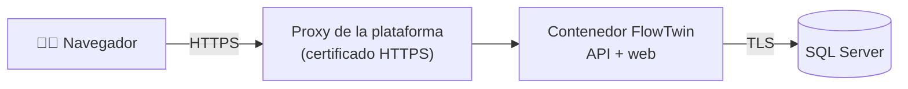

# Despliegue de CREO FlowTwin

Esta guía explica cómo poner FlowTwin en un servidor. No hace falta conocer el código: basta con seguir los pasos.
Para correrlo en una computadora y programar, ver el [README](../README.md#-instalación-y-uso).

| Escenario | Para qué | Estado |
|---|---|---|
| [A. Demo en la nube](#a-demo-en-la-nube-render--azure-sql) | Que la clínica y el equipo prueben el sistema desde el navegador | Listo |
| [B. Instalación en la clínica](#b-instalación-en-la-clínica) | Uso real con los nodos ESP32 | Pendiente: ver lo que cambia |

---

## Cómo está armado

Una sola imagen de Docker ([`Dockerfile`](../Dockerfile)) contiene la API y la aplicación web, en el mismo dominio.
La base de datos (SQL Server) va aparte.



- **HTTPS** lo pone la plataforma (Render). La aplicación pide al navegador volver siempre por HTTPS (HSTS).
- **Sin secretos en la imagen.** Contraseñas y claves se pasan como variables de entorno. Si falta una, la aplicación
  **no arranca** y dice cuál falta.
- **La base se actualiza sola** al arrancar (migraciones), si `BaseDatos__MigrarAlIniciar=true`.

---

## Variables de entorno

| Variable | Obligatoria | Qué es |
|---|:---:|---|
| `ConnectionStrings__FlowTwin` | ✅ | Conexión a SQL Server, con su usuario y contraseña. **Secreto.** |
| `Jwt__Clave` | ✅ | Firma las sesiones. Mínimo 32 caracteres al azar. **Secreto.** |
| `Auditoria__ClaveSello` | ✅ | Sella la bitácora contra alteraciones. Base64 de 32 bytes o más. **Secreto, y hay que guardar una copia aparte** (ver más abajo). |
| `AdminInicial__Correo` | La primera vez | Correo del primer Administrador. |
| `AdminInicial__ClaveTemporal` | La primera vez | Su contraseña temporal (12 caracteres o más; la cambia al entrar). **Secreto.** |
| `AdminInicial__Nombres`, `AdminInicial__Apellidos` | No | Nombre del primer Administrador. |
| `BaseDatos__MigrarAlIniciar` | Sí, `true` | Crea o actualiza las tablas al arrancar. |
| `Contrasenas__ExigirCambioPrimerIngreso` | Recomendada, `true` | Obliga a cambiar la contraseña temporal en el primer ingreso. |
| `Demo__SimulacionDisponible` | Solo demo, `true` | Muestra el botón **Simulación** (datos ficticios, marcados en morado). En la clínica, `false`. |
| `Mqtt__Activo` | Solo demo, `false` | Apaga la conexión con los nodos (no hay hardware en la demo). |
| `Mqtt__ClaveAdmin` | Si `Mqtt__Activo=true` | Clave del administrador del broker MQTT. **Secreto.** |

Para generar las claves al azar (en Linux, macOS o Git Bash):

```bash
openssl rand -base64 48     # sirve para Jwt__Clave y para Auditoria__ClaveSello (una distinta para cada una)
```

> **Nunca uses los usuarios de demostración (`demo123`) en un servidor.** Fuera de desarrollo no se crean: el primer
> acceso es el Administrador de `AdminInicial`, y él crea a los demás desde **Usuarios**.

---

## A. Demo en la nube (Render + Azure SQL)

Costo: **cero**, con los planes gratuitos. Lo que implica:

- La aplicación **se duerme tras 15 minutos sin uso** y tarda alrededor de un minuto en despertar con la primera visita.
- **Sin nodos reales:** el gemelo y el historial se ven con la **Simulación**.
- La base gratuita de Azure tiene un tope mensual de uso; si se alcanza, **se pausa hasta el mes siguiente** (no cobra).
- La maqueta 3D del Piso 1 viaja dentro de la imagen y está en el repositorio público, con permiso del sponsor.

### 1. Base de datos en Azure

1. Crea una cuenta en [Azure for Students](https://azure.microsoft.com/free/students) con el correo de la universidad
   (no pide tarjeta).
2. En el [portal de Azure](https://portal.azure.com), busca **Azure SQL Database** → **Crear**. Si aparece la
   **oferta gratuita** («Apply offer»), aplícala.
3. Datos de la base:
   - **Servidor:** crea uno nuevo, con **autenticación SQL** (usuario y contraseña propios). Anótalos en un lugar seguro.
   - **Región:** la misma zona que elijas en Render (por ejemplo, este de EE. UU.), para que respondan rápido.
   - **Cuando se alcance el límite gratuito:** elige **pausar la base hasta el próximo mes**. Así nunca cobra.
4. **Redes:** permite el acceso **solo** desde las direcciones de salida de Render (Render las muestra en el servicio:
   *Connect → Outbound*). Agrégalas en **Firewall rules** del servidor. No abras la base a todo internet.
5. Copia la **cadena de conexión ADO.NET** (*Connection strings*) y pon tu contraseña donde dice `{your_password}`.
   Debe tener `Encrypt=True`. Esa cadena es el valor de `ConnectionStrings__FlowTwin`.

### 2. Aplicación en Render

1. Crea una cuenta en [Render](https://render.com) entrando con GitHub.
2. **New → Web Service** → elige el repositorio **FlowTwin-CREO**.
3. Configuración:
   - **Branch:** `develop` para la demo; `main` cuando haya versión estable.
   - **Language / Runtime:** Docker (usa el `Dockerfile` de la raíz).
   - **Region:** la misma zona que la base.
   - **Instance type:** Free.
4. **Environment:** agrega las variables de la tabla de arriba. Para la demo:

   ```
   ConnectionStrings__FlowTwin            = (la cadena de Azure)
   Jwt__Clave                             = (openssl rand -base64 48)
   Auditoria__ClaveSello                  = (openssl rand -base64 48, otra distinta)
   AdminInicial__Correo                   = tu-correo@upch.pe
   AdminInicial__ClaveTemporal            = (12 caracteres o más)
   BaseDatos__MigrarAlIniciar             = true
   Contrasenas__ExigirCambioPrimerIngreso = true
   Demo__SimulacionDisponible             = true
   Mqtt__Activo                           = false
   ```

   La aplicación escucha en el puerto que Render indica en `PORT`; no hace falta configurarlo.
5. **Health Check Path:** `/api/v1/salud`.
6. **Deploy.** La primera vez compila la imagen (unos minutos) y luego crea las tablas en Azure.

### 3. Primer ingreso

1. Abre la dirección que da Render (`https://…onrender.com`).
2. Entra con `AdminInicial__Correo` y la contraseña temporal; el sistema te pide cambiarla.
3. En **Usuarios**, crea las cuentas de quienes van a probar (Operador, Gerencia). Cada una recibe una contraseña
   temporal que se muestra **una sola vez**.
4. Ya creado el Administrador, **borra `AdminInicial__ClaveTemporal`** de Render: no se vuelve a usar.

### 4. Comprobar que todo funciona

| Qué | Cómo | Esperado |
|---|---|---|
| Salud | Abrir `https://…onrender.com/api/v1/salud` | Responde que la base está bien |
| Ingreso | Entrar con el Administrador | Abre el Gemelo en vivo |
| Gemelo | Menú → **Simulación** | Pacientes moviéndose sobre la maqueta 3D |
| Seguridad | `curl -I https://…onrender.com` | Cabeceras `Strict-Transport-Security` y `Content-Security-Policy` |

### 5. Actualizar

Cada `push` a la rama elegida vuelve a desplegar solo. Si hay migraciones nuevas, se aplican al arrancar.

---

## Claves: cambiarlas y guardarlas

| Clave | Si se cambia | Copia aparte |
|---|---|---|
| `Jwt__Clave` | Todos deben volver a iniciar sesión. Nada más. | No hace falta |
| Contraseña de la base | Actualizar `ConnectionStrings__FlowTwin` y redesplegar. | Sí, en un gestor de contraseñas |
| `Auditoria__ClaveSello` | **No cambiarla.** Los registros ya sellados dejarían de poder verificarse. | **Sí, obligatoria**, fuera del servidor (ADR-30) |

Si se sospecha que una clave se filtró: cambiarla, revisar **Auditoría** y, si es la de la base, rotar también la
contraseña en Azure.

## Respaldos

- **Demo (Azure SQL):** Azure hace respaldos automáticos y permite restaurar la base a un momento anterior desde el
  portal (*Restore*).
- **Clínica:** ver el escenario B.

---

## B. Instalación en la clínica

Es el destino real. Usa la misma imagen y las mismas variables, con estos cambios:

| Tema | Demo | Clínica |
|---|---|---|
| Nodos | Sin nodos (Simulación) | `Mqtt__Activo=true`, broker Mosquitto con **TLS en el puerto 8883**; el firmware lleva el certificado de la CA |
| Simulación | `Demo__SimulacionDisponible=true` | `false` |
| HTTPS | Lo pone Render | Un proxy (por ejemplo Caddy) con el certificado de la clínica |
| Base de datos | Azure SQL gratuita | SQL Server **Express** (gratuito y válido en producción; Developer no lo es) o la que indique la clínica |
| Respaldos | Los de Azure | Respaldo diario, copia **fuera del servidor** y prueba de restauración periódica |
| Maqueta 3D | Dentro de la imagen | Carpeta del servidor (`Maquetas__Ruta`), fuera del repositorio (ADR-28) |

Estos puntos están en la hoja de ruta del [README](../README.md#️-hoja-de-ruta) y en los pendientes del
[informe de seguridad](seguridad/informe-seguridad.md).

---

## Solución de problemas

| Síntoma | Causa probable | Qué hacer |
|---|---|---|
| La página tarda un minuto en abrir | La demo estaba dormida | Esperar; es normal en el plan gratuito |
| El despliegue falla con «Faltan secretos para arrancar» | Falta una variable obligatoria | El mensaje dice cuál; agregarla en Render |
| «La base de datos no respondió» | Firewall de Azure, cadena incorrecta o base pausada por el tope mensual | Revisar las reglas de red y la cadena; en el portal, ver el estado de la base |
| No aparece el botón Simulación | `Demo__SimulacionDisponible` no es `true` | Agregarla y redesplegar |
| El gemelo dice que la maqueta está «en producción» | La imagen se compiló sin `maquetas/piso-1` | Revisar que la carpeta esté en la rama desplegada |
